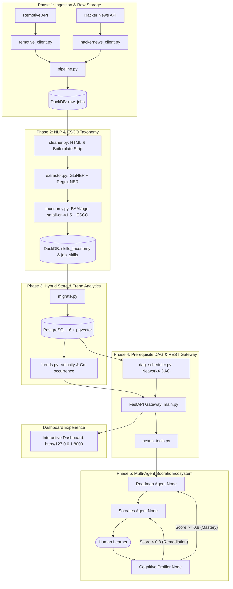
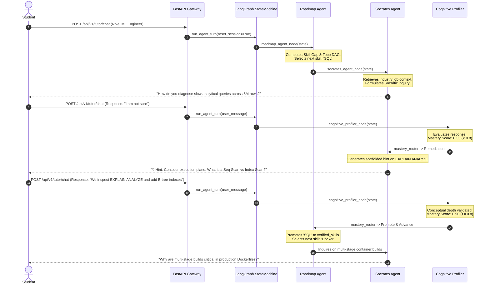

# NEXUS — Autonomous Multi-Agent Learning Ecosystem

[](https://fastapi.tiangolo.com)
[](https://langchain-ai.github.io/langgraph/)
[](https://duckdb.org)
[](https://github.com/pgvector/pgvector)
[](https://python.org)

**NEXUS** is an end-to-end autonomous learning ecosystem that bridges real-world hiring market demand with personalized, adaptive technical education. NEXUS continuously ingests job postings, extracts technical competencies, normalizes them against the European Skills/Competences (ESCO) standard, models skill dependencies as a topological Directed Acyclic Graph (DAG), and orchestrates three specialized AI agents to deliver interactive Socratic tutoring.

```
Job Market Data ➔ Data Engineering ➔ NLP Skill Extraction ➔ Skill Taxonomy ➔ 
Market Analytics ➔ Skill-Gap Analysis ➔ Learning Roadmap ➔ AI Tutoring ➔ 
Mastery Evaluation ➔ Adaptive Learning
```

---

## 1. System Architecture



---

## 2. Multi-Agent Pedagogical Loop



---

## 3. Technology Stack

| Component | Technology | Rationale |
|---|---|---|
| **Raw Warehouse** | DuckDB | Embedded, zero-configuration OLAP database ideal for fast local processing. |
| **Production Store** | PostgreSQL 16 + pgvector | Unified relational schema with HNSW cosine similarity search. |
| **NLP & NER** | GLiNER / Custom Regex Engine | Zero-shot entity recognition extracting programming languages, frameworks, and tools without paid API latency. |
| **Semantic Embeddings** | SentenceTransformers (`BAAI/bge-small-en-v1.5`) | Compact, high-fidelity 384-dimensional dense embeddings. |
| **Taxonomy Standard** | ESCO Skills Taxonomy | Standardized European Skills classification aligning industry aliases. |
| **Dependency Scheduling** | NetworkX | Directed Acyclic Graph (DAG) cycle detection and topological sorting. |
| **REST Gateway** | FastAPI + Pydantic v2 | High-throughput async REST endpoints with automatic OpenAPI documentation. |
| **Multi-Agent Engine** | LangGraph + LangChain | Cyclic state machine with Knowledge Tracing and interruptible human-in-the-loop turns. |
| **Frontend UI** | HTML5 / CSS3 / Vanilla JS | Zero-build responsive web dashboard for real-time tutoring and roadmap inspection. |

---

## 4. Repository Structure

```text
capstone/
├── data/
│   ├── nexus_jobs.duckdb        # Local DuckDB raw & NLP database
│   └── skills_en.csv            # ESCO taxonomy dataset
├── src/
│   ├── ingestion/               # Phase 1: Data Ingestion
│   │   ├── db.py                # DuckDB schema, dedup hashing & insertion
│   │   ├── remotive_client.py   # Remotive API client with retries
│   │   ├── hackernews_client.py # Hacker News "Who is hiring" comment parser
│   │   └── pipeline.py          # End-to-end ingestion orchestrator
│   ├── nlp/                     # Phase 2: NLP & Skill Extraction
│   │   ├── cleaner.py           # HTML stripping & boilerplate filter
│   │   ├── extractor.py         # GLiNER zero-shot & regex NER
│   │   ├── taxonomy.py          # ESCO alignment & emerging skill detection
│   │   └── orchestrator.py      # Batch NLP processing pipeline
│   ├── database/                # Phase 3: Hybrid Store & Migration
│   │   ├── schema.sql           # PostgreSQL 16 + pgvector schema & HNSW index
│   │   └── migrate.py           # DuckDB ➔ PostgreSQL migration & vectorizer
│   ├── analytics/               # Phase 3: Market Analytics
│   │   └── trends.py            # Skill demand, velocity & co-occurrence
│   ├── engine/                  # Phase 4: DAG Scheduling
│   │   └── dag_scheduler.py     # Topological DAG & Skill-Gap Engine
│   ├── api/                     # Phase 4: REST Gateway
│   │   ├── schemas.py           # Pydantic request & response models
│   │   ├── db.py                # PostgreSQL vector & DuckDB retrieval
│   │   └── main.py              # FastAPI endpoints & static mount
│   └── agents/                  # Phase 5: Multi-Agent System
│       ├── state.py             # LearnerState TypedDict schema
│       ├── prompts.py           # Pedagogical prompts for Socrates & Profiler
│       ├── nodes.py             # Agent nodes (Roadmap, Socrates, Profiler)
│       ├── orchestrator.py      # LangGraph StateGraph & session persistence
│       └── nexus_tools.py       # Dual-callable tool wrappers
├── static/
│   └── index.html               # Unified Web Dashboard
├── tests/                       # Comprehensive Test Suite
│   ├── test_ingestion.py        # Phase 1 tests
│   ├── test_nlp.py              # Phase 2 tests
│   ├── test_database.py         # Phase 3 tests
│   ├── test_dag_scheduler.py    # Phase 4 DAG tests
│   ├── test_api.py              # Phase 4 API tests
│   ├── test_agents.py           # Phase 5 Multi-Agent tests
│   └── test_e2e.py              # End-to-end student workflow tests
├── docker-compose.yml           # PostgreSQL 16 + pgvector container
├── run_app.py                   # Application launch script (Port 8000)
├── test_flow.py                 # Multi-agent pedagogical loop test script
├── test_agent.py                # DAG and tool validation script
├── process.txt                  # Full implementation process audit log
├── requirements.txt             # Project dependencies
└── README.md                    # Project documentation
```

---

## 5. Prerequisites & Installation

### Windows PowerShell Setup

1. **Activate Existing Virtual Environment:**
   ```powershell
   .\venv\Scripts\Activate.ps1
   ```

2. **Install Dependencies:**
   ```powershell
   pip install -r requirements.txt
   ```

3. **Configure Environment Variables:**
   ```powershell
   Copy-Item .env.example .env
   ```
   *(Optional)* Edit `.env` to configure `OPENAI_API_KEY` for GPT-4o tutoring. If left blank, NEXUS automatically runs with its intelligent built-in pedagogical simulator.

---

## 6. Execution Guide (Step-by-Step)

### Step 1: Run Phase 1 Data Ingestion
Fetches live tech job postings from Remotive and Hacker News into DuckDB:
```powershell
python src\ingestion\pipeline.py
```

### Step 2: Run Phase 2 NLP Skill Extraction
Cleans raw text, extracts technical entities, and normalizes skills against ESCO:
```powershell
python src\nlp\orchestrator.py
```

### Step 3: Run PostgreSQL & Phase 3 Migration (Optional / Production Mode)
Start the PostgreSQL container:
```powershell
docker-compose up -d
```
Migrate data from DuckDB into PostgreSQL with 384-dimensional dense vectors:
```powershell
python src\database\migrate.py
```
Inspect hiring velocity and co-occurrences:
```powershell
python src\analytics\trends.py
```

### Step 4: Verify Phase 4 DAG & Phase 5 Agents
Run automated integration scripts:
```powershell
python test_agent.py
python test_flow.py
```

### Step 5: Launch the Interactive Web Application
```powershell
python run_app.py
```
- **Web Dashboard:** [http://127.0.0.1:8000](http://127.0.0.1:8000)
- **Interactive Swagger Docs:** [http://127.0.0.1:8000/docs](http://127.0.0.1:8000/docs)

---

## 7. Running the Complete Test Suite

Run pytest across all phases:
```powershell
pytest -v
```

All unit, integration, and end-to-end tests validate:
- Deduplication and resilient parsing of malformed listings.
- HTML cleaning, boilerplate exclusion, and alias normalization.
- Vector embedding dimensions and temporal velocity metrics.
- Cycle prevention in prerequisite DAGs and topological trajectories.
- FastAPI endpoints and status contracts.
- Socratic scaffolding, Cognitive Profiler knowledge tracing, and state persistence.

---

## 8. API Specification

| Method | Endpoint | Description |
|---|---|---|
| `GET` | `/api/v1/health` | Service health and database readiness check. |
| `GET` | `/api/v1/market/trends` | In-demand tech skills ranking and WoW velocity metrics. |
| `POST` | `/api/v1/roadmaps/gap-analysis` | Computes skill gaps and topological learning trajectory. |
| `POST` | `/api/v1/context/retrieve-jobs` | Semantic vector search for real-world job snippets. |
| `POST` | `/api/v1/tutor/chat` | Interactive multi-turn Socratic tutoring dialogue. |
